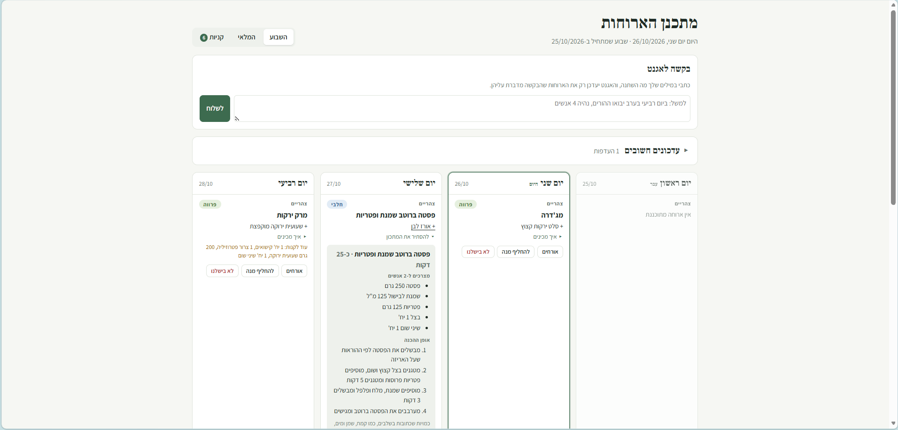
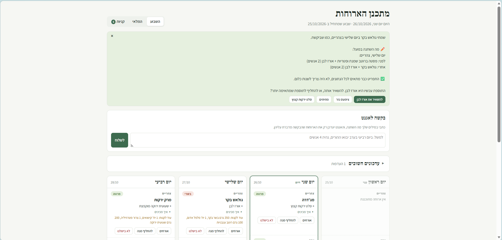
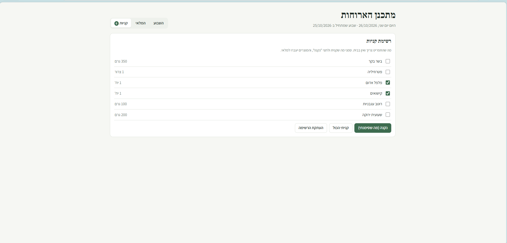

# מתכנן ארוחות: אג'נט לתכנון השבוע

אג'נט שמקבל מטרה ("לתכנן צהריים וערב לימים שנשארו בשבוע") ומחליט בעצמו איך להגיע אליה.
הוא בודק מה יש בבית, בוחר מנות שמשתמשות במה שעומד להיגמר, ומחזיר תפריט ורשימת קניות
קצרה ככל האפשר. הוא רץ בטרמינל וגם כאפליקציה בדפדפן, שבה מעדכנים את השבוע תוך כדי.

---

## 1. הבעיה, ולמה בחרתי בה

התחתנתי לא מזמן, ב"ה, והבית החדש הביא איתו שאלה שחוזרת כל יום: מה מבשלים היום?
מהר מאוד הבנתי שהשאלה היא לא רק מה לבשל. צריך לדעת מראש מה לקנות, להשתמש במה
שכבר יש במקרר לפני שהוא מתקלקל, לגוון, ולהסתדר כשמגיעים אורחים או כשמשהו משתנה באמצע
השבוע.

זו בדיוק בעיה שמתאימה לאג'נט. אין לה נוסחה אחת, יש בה הרבה אילוצים שתלויים זה בזה,
והיא מחייבת שיקול דעת: איזו מנה הכי נכונה מבין כמה אפשרויות טובות, ואיך משנים יום אחד
בלי לפרק את כל השבוע.

**מה האג'נט עושה:** הוא מקבל מטרה, ולולאה של מודל שפה (GPT-4o-mini) מחליטה בכל צעד מה
לעשות: לבדוק את המלאי, לחפש מנות מתאימות ממאגר המתכונים האישי שלנו, להוסיף ארוחה
לתפריט או להחליף אותה. הוא קורא את תוצאת כל פעולה, משנה כיוון כשמשהו נכשל, ועוצר כשהתפריט
מלא, או כשהוא מגיע למסקנה שמשבצת מסוימת לא אפשרית ומסביר למה. בסוף הוא כותב סיכום עם
ההחלטות שלו. במהלך השבוע אפשר לבקש ממנו במילים פשוטות: "מחר בצהריים יהיו 5 אנשים",
"תוסיף פירה ליום חמישי", "משהו קליל יותר בערב".

---

## 2. התקנה והפעלה

**מה צריך:** Python 3.10 ומעלה, ומפתח API של OpenAI.

### התקנת התלויות

```
py -m pip install -r requirements.txt
```

(במק או בלינוקס: `python3 -m pip install -r requirements.txt`. הפרויקט צריך רק את הספרייה `openai`.)

### מפתח ה-API

המפתח לא נכתב בקוד. יש שתי דרכים לתת אותו:

- **קובץ `.env` (הכי פשוט):** מעתיקים את `.env.example` לקובץ חדש בשם `.env`, וכותבים בו את
  המפתח: `OPENAI_API_KEY=sk-...`. הקובץ `.env` לא עולה ל-GitHub.
- **משתנה סביבה:** ב-Windows: `setx OPENAI_API_KEY "sk-..."`, ואז פותחים מחדש את חלון הטרמינל.

מפתח יוצרים בכתובת https://platform.openai.com/api-keys.

### הרצה בטרמינל

```
py main.py plan                                    תכנון השבוע (האג'נט)
py main.py today                                   מה מבשלים היום, עם המתכונים
py main.py change "בשלישי בצהריים יהיו 5 אנשים"     שינוי במילים פשוטות (האג'נט)
py main.py                                         תפריט לבחירה
```

אפשר להוסיף `--date 2026-10-27` כדי להריץ כאילו היום הוא תאריך אחר (נוח לבדיקה).

### הרצה בדפדפן

```
py web.py
```

הדפדפן נפתח בכתובת http://localhost:8765. לסגירה: Ctrl+C בחלון הטרמינל.

- **השבוע:** התפריט. לחיצה על מנה פותחת את המתכון, עם כמויות לפי מספר האנשים. ליד כל ארוחה יש כפתורים: אורחים, להחליף מנה, לא בישלנו. יש גם תיבה לבקשות במילים חופשיות: "תוסיף גם סלט ליום שלישי" מוסיף מנה ליד מה שיש, ו"במקום האורז, מרק" מחליף.
- **איך היה?** אחרי שאוכלים, מדרגים כל מנה בנפרד ב-👍 או ב-👎. הדירוגים נשמרים משבוע לשבוע, והאג'נט מעדיף את מה שאהבתם.
- **עדכונים חשובים:** כמה אנשים בבית ואילו ימים לתכנן, מצרכים שלא אוכלים אף פעם (אלרגיות), והעדפות קבועות ("בימי שלישי בערב בשרי"). אחרי כל שינוי, התפריט מותאם מיד.
- **המלאי:** כל מה שיש בבית, וטופס לקנייה חדשה.
- **קניות:** הרשימה. מסמנים מה נקנה, והמוצרים עוברים למלאי. קנית פחות או יותר? משנים את הכמות, והשאר נשאר ברשימה. אפשר גם להעתיק את הרשימה לוואטסאפ.
- **שבוע חדש:** בתחילת שבוע מוצג המלאי שנשאר מהשבוע הקודם. מאשרים, ואז מתכננים.

### הרצת הבדיקות

```
py -m unittest
```

187 בדיקות. הן רצות עם AI מדומה ועל נתונים זמניים, ולכן לא צריך מפתח, הן לא עולות כסף,
והן לא נוגעות בקבצים שבתיקייה `data`.

---

## 3. הדגמה

### פלט של הרצה

שתי הרצות אמיתיות, כל אחת עם כל הצעדים שהאג'נט בחר. מתחת לכל החלטה מופיע הנימוק שלו ("למה:").

- **תכנון השבוע** ([`demo/plan-run.txt`](demo/plan-run.txt)), הפקודה `py main.py plan`: האג'נט בודק
  את המלאי, ממלא משבצת אחרי משבצת לפי האפשרויות שהוא מקבל, ובודק בסוף שהתפריט מלא. אחר כך
  מופיעים התפריט, רשימת הקניות והסיכום.
- **שינוי באמצע השבוע** ([`demo/change-run.txt`](demo/change-run.txt)), הפקודה
  `py main.py change "משהו קליל יותר ביום חמישי בערב"`: בקשה פתוחה, בלי שם של מנה. האג'נט מחליט
  על איזו ארוחה מדובר ונועל רק אותה. בצעד 3 הוא מקבל שגיאה ("הארוחה כבר מתוכננת"), מבין ממנה
  שקודם צריך להוציא אותה, ובוחר מנה קלה יותר. בסוף רואים מה בדיוק השתנה ומה צריך לקנות בגלל השינוי.

### צילומי מסך מהאפליקציה

**התפריט של השבוע**, עם מתכון פתוח (המצרכים מותאמים למספר האנשים):



**בקשה במילים חופשיות:** האג'נט הבין את הבקשה, שינה רק את הארוחה שהיא מדברת עליה, הראה מה
השתנה, ושאל אם להשאיר את התוספת עם המנה החדשה:



**רשימת הקניות:** רק מה שהתפריט צריך ואין בבית. מה שמסמנים כ"נקנה" עובר למלאי:



---

## 4. איך האג'נט בנוי

### מפה לקריאת הקוד

**לב האג'נט הוא שלושה קבצים.** כדאי לקרוא אותם בסדר הזה:

1. **`prompts.py`: מה האג'נט מקבל.** `SYSTEM_PROMPT` הן ההוראות שלו: איך לעבוד, איך לבחור ומתי לסיים. `plan_goal` היא המטרה. `tool_schemas` מתארת לו את הכלים.
2. **`agent.py`: הלולאה.** `run_agent` שולחת למודל את המטרה, מריצה את הכלי שהוא בחר (`_run_tool`), מחזירה לו את התוצאה, וחוזרת על זה עד תנאי הסיום. כל אחד מתנאי הסיום מסומן בה בהערה.
3. **`tools.py`: הכלים והכללים.** המחלקה `MealPlanner`: כל פונקציה ציבורית בה היא כלי של האג'נט. החשובים הם `find_meal_options` (מה מתאים למשבצת) ו-`add_meal_to_plan` (מוסיף ארוחה, אחרי שהוא בודק שוב כל כלל).

**השאר נבנה מעל האג'נט ומשתמש בו:**

- **`main.py`:** הפעלה בטרמינל.
- **`web.py` ו-`web/index.html`:** האפליקציה בדפדפן.
- **`household.py`:** עדכוני נתונים בלי AI, כמו מלאי, קניות ושבוע חדש, והתאמה של התפריט לכללים אחרי כל שינוי.

כדי להבין את האג'נט מספיק לקרוא את שלושת הקבצים הראשונים.

### המוח, הכלים והלולאה

| חלק | אצלנו |
|---|---|
| **מוח** | GPT-4o-mini, דרך function calling של OpenAI (`agent.py`) |
| **כלים** | 13 כלים: מלאי, חיפוש מתכונים, אפשרויות לכל משבצת, בדיקת התאמה, הוספה, החלפה והסרה של ארוחה ועוד (`tools.py`) |
| **לולאה** | `run_agent`: שולחת למודל את המטרה, מריצה את הכלי שבחר, מחזירה לו את התוצאה, וחוזרת על זה עד שהוא מסיים (`agent.py`) |

### חמשת הרכיבים שהמשימה מבקשת

| רכיב | איפה זה בקוד |
|---|---|
| **קבלת מטרה** | `plan_goal` ו-`change_goal` ב-`prompts.py`: "לתכנן צהריים וערב לימים X, ל-2 אנשים, עם מינימום קניות" |
| **קבלת החלטות** | המודל בוחר בכל צעד את הכלי הבא, ובוחר בין אפשרויות תקינות לפי גיוון, מוצרים שעומדים לפוג וכמות קניות. כל החלטה שמשנה את התפריט באה עם נימוק קצר, שמופיע בפלט (פירוט בהמשך) |
| **שימוש בכלים** | 13 כלים ב-`tools.py`. כל כלי מחזיר תוצאה או שגיאה עם רמז מה לנסות במקום |
| **בחינת התוצאה** | המודל קורא כל תוצאה ומשנה כיוון. הקוד גם חוסם ניסיון חוזר של פעולה שכבר נכשלה, ומשווה את הסיכום של המודל למה שבאמת השתנה בתפריט |
| **תנאי סיום** | המודל מסיים כשהתפריט מלא. אם הוא עוצר מוקדם, הוא מתבקש להמשיך (עד פעמיים). הלולאה עוצרת אחרי 80 צעדים או בתקרת עלות של 20 סנט, ומדווחת מה לא הושלם |

### אילו החלטות האג'נט מקבל

הכללים הקבועים, כמו אלרגיות ומגבלת הקניות, נבדקים בקוד. כל השאר הוא שיקול הדעת של האג'נט.

**בתכנון השבוע:**
- **מה הצעד הבא:** לבדוק את המלאי, את מצב התפריט, אילו מנות מתאימות למשבצת, או להוסיף ארוחה. הוא קובע גם באיזה סדר למלא את המשבצות.
- **איזו מנה לבחור** מבין כל האפשרויות שעומדות בכללים:
  - קודם מנות שמשתמשות במוצרים שעומדים לפוג.
  - מנות שצריך לקנות להן כמה שפחות.
  - גיוון: לא מנות דומות ימים ברצף, איזון בין ארוחות בשר, חלב וצמחוניות, ופיזור של התוספות.
  - מה שהמשפחה אהבה: מנות שקיבלו 👍 קודם, ומנות שקיבלו 👎 רק אם אין ברירה.
- **לחשוב קדימה:** לא לבזבז מנה או מצרך שמשבצת אחרת בהמשך השבוע צריכה.
- **לחזור אחורה:** כשאין אפשרות למשבצת, להבין איזו בחירה קודמת חוסמת אותה, ולשנות אותה.
- **ללמוד משגיאות:** כשכלי דוחה בחירה, הוא קורא את הסיבה ואת הרמז, ובוחר אחרת. הוא לא חוזר על אותו ניסיון.
- **מתי לעצור:** כשהתפריט מלא, או כשמשבצת באמת לא אפשרית. אז הוא מסביר למה.

**במהלך השבוע, כשמבקשים במילים פשוטות:**
- **מה התבקש:** מנה מסוימת ("תוסיף פירה ליום חמישי"), אורחים ("מחר בצהריים נהיה 5"), שינוי במתכון ("תוסיף כמון לשקשוקה") או בקשה פתוחה ("משהו קליל יותר בערב").
- **על אילו ארוחות מדובר**, ואם בכלל צריך לשנות משהו. אם לא, הוא לא נוגע בתפריט ומסביר למה.
- **מה לבשל במקום** כשמחליפים מנה: מה הכי מתאים לשאר השבוע.
- **להבין העדפה קבועה** ("בימי שלישי בערב משהו בשרי"), ולתרגם אותה לכלל שהקוד בודק מעכשיו בכל תכנון.

בסוף כל הרצה הוא כותב סיכום עם ההחלטות שלו ("ביום רביעי בחרתי בפילה דג כי הוא בבית ולא
צריך לקנות לו כלום").

### המתכונים: מאגר אישי ולא חיפוש באינטרנט

האג'נט בוחר מתוך מאגר מתכונים אישי (`data/recipes.json`), ולא מחפש מתכונים בגוגל. בחרתי
בזה בכוונה:

- **אלה המתכונים שאנחנו באמת מבשלים ואוהבים.** תפריט ממתכונים אקראיים מהאינטרנט נשמע טוב, אבל בפועל לא מבשלים אותו.
- **כמויות מדויקות.** לכל מצרך במאגר יש כמות ויחידת מידה קבועה (גרם, מ"ל, יחידות). רק כך אפשר לחשב בדיוק מה לקחת מהמלאי ומה לקנות, ולהתאים כמויות למספר האנשים. במתכונים מהאינטרנט כתוב "כוס", "חופן" או "לפי הטעם", ואי אפשר לחשב מהם רשימת קניות.
  לדוגמה: בקציצות כתוב במאגר "בשר טחון 500 גרם ל-4 מנות". לשני אנשים התוכנית מחשבת 250 גרם. אם בבית יש 300 גרם, לא צריך לקנות כלום ונשארים 50 גרם פנויים לארוחה אחרת. ממתכון שכתוב בו "חצי קילו בשר בערך" אי אפשר לחשב את זה.
- **אמינות.** המודל בוחר רק מתוך מתכונים שקיימים במאגר. הוא לא יכול להמציא מתכון או כמות.
- **פשוט, מהיר וזול.** אין תלות בחיפוש באינטרנט, ובכל פנייה למודל נשלח מידע קצר וקבוע.

**המחיר של הבחירה הזו:** המאגר מוגבל, ומישהו צריך להכניס אליו מתכונים, ולכן הוא לא מגוון כמו כל
האינטרנט. כדי שזה לא יגביל את המשפחה, יש דרך להרחיב אותו תוך כדי שימוש:
כשמבקשים מנה שאין במאגר ("ירקות מאודים"), האג'נט מציע ליצור לה מתכון, או לבחור מנה אחרת
שמתאימה לארוחה. במתכון החדש הוא משתמש במצרכים שהתוכנית מכירה, ואם המנה צריכה מצרך חדש
(למשל חצילים), הוא מוסיף אותו עם יחידת מידה. הקוד בודק את המתכון: מצרך בלי יחידה מוכרת נפסל,
וסוג הארוחה נקבע לפי המצרכים. אחר כך המתכון נשמר במאגר לפעמים הבאות.

### החלטות עיקריות בבנייה

- **הכללים בקוד, שיקול הדעת אצל המודל.** אלרגיות, גיוון, התאמה בין שתי הארוחות של אותו יום ומגבלת קניות נבדקים בקוד, כך שטעות של המודל נדחית עם הסבר ולא נכנסת לתפריט. למודל נשארת ההחלטה האמיתית: איזו אפשרות טובה יותר לשבוע כולו.
- **המודל מבין, הקוד מבצע.** בבדיקות ראיתי שהמודל הזול מבין טוב בקשות, אבל לא תמיד מבצע נכון סדרה של צעדים. לכן בקשה כמו "תוסיף פירה ליום חמישי" נקראת פעם אחת על ידי המודל, והקוד מבצע אותה בדיוק. בקשות פתוחות ("משהו קליל יותר") עדיין עוברות ללולאת האג'נט המלאה.
- **התפריט תמיד מתאים לנתונים.** אחרי כל שינוי (מלאי, העדפה, אלרגיה) הקוד בודק אילו ארוחות כבר לא מתאימות ומחליף רק אותן. שינוי שמפר כלל קבוע מתבטל כולו, כך שהתפריט אף פעם לא נשאר במצב לא תקין.
- **בקשה מפורשת גוברת על גיוון.** מנה שהמשתמשת ביקשה בשם נכנסת לתפריט גם אם היא חוזרת השבוע. היא לא גוברת על אלרגיות, על הכללים הקבועים או על ההעדפות הקבועות.
- **שליטה בעלות.** תקרת עלות לכל הרצה, ותוצאות ישנות של כלים מקוצרות כדי לחסוך טוקנים. תכנון של שבוע שלם עולה בערך 2 סנט.
- **טיפול בשגיאות.** מפתח חסר או שגוי, קרדיט שנגמר, חיבור שנפל (עם ניסיון חוזר), קובץ נתונים פגום, וכלי שהמודל קרא לו לא נכון: כל אחד מקבל הודעה ברורה בעברית ולא קריסה.

---

## מבנה הקבצים

| קובץ | מה יש בו |
|---|---|
| `agent.py` | הלולאה של האג'נט, הפנייה ל-OpenAI, והבנת בקשות, העדפות ומתכונים חדשים |
| `tools.py` | הכלים של האג'נט וכל כללי התכנון (גיוון, כמויות, התאמה בין הארוחות) |
| `prompts.py` | כל מה שהמודל קורא: ההוראות, המטרות ותיאורי הכלים |
| `household.py` | עדכון הנתונים בלי AI: מלאי, קניות, שבוע חדש, והתאמת התפריט לכללים |
| `main.py` | ההפעלה בטרמינל |
| `web.py`, `web/index.html` | האפליקציה בדפדפן |
| `data/` | המתכונים, המלאי וההעדפות |
| `output/` | התפריט השמור (`plan.json`) ועותק קריא (`menu.txt`) |
| `tests/` | הבדיקות |
